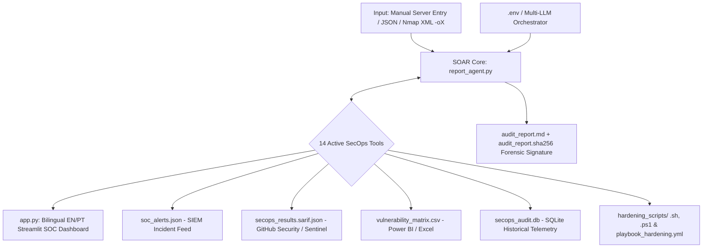

# 🛡️ AutoSecReport-AI — Autonomous SOAR & Global SOC Command Center (14 Tools)


-FF4B4B?logo=streamlit&logoColor=white)


> 🇺🇸 **English (US Enterprise Edition)** | 🇧🇷 [Português abaixo](#-versão-em-português-brasil)

**AutoSecReport-AI** is a dual-architecture **Security Orchestration, Automation, and Response (SOAR)** platform built in Python. It operates both via **CLI** (for DevSecOps CI/CD pipelines) and via a **Real-Time Bilingual Streamlit SOC Command Center (`app.py`)** that initializes in a clean **Zero-State (`0 hosts`)** and scales dynamically as servers or Nmap XML scans are ingested.

---

## 🏗️ System Architecture



## 🛠️ 14-Tool Autonomous SecOps Catalog (Function Calling)

1. **`buscar_cve_servico`:** Maps CVEs, **CVSS v3**, **EPSS** exploitation probability, and **US CISA KEV** (*Known Exploited Vulnerabilities*) status.
2. **`calcular_score_host`:** Computes weighted Host Risk Scores (`0-100`) based on exposed port criticality.
3. **`verificar_porta_ativa`:** Performs active TCP connectivity probing via Python's native `socket` library.
4. **`validar_headers_http`:** Audits HTTP security headers (`HSTS`, `CSP`, `X-Frame-Options`) and deprecated TLS 1.0/1.1 protocols.
5. **`gerar_regra_firewall`:** Generates exact inbound blocking/limiting rules for **Linux UFW** and **Windows Defender Firewall**.
6. **`exportar_script_hardening`:** Exports ready-to-run remediation scripts (`.sh` and `.ps1`) per host into `hardening_scripts/`.
7. **`mapear_compliance_cis`:** Cross-maps vulnerabilities to **US SOC 2 Type II**, **PCI-DSS v4.0**, **US HIPAA Security Rule**, **NIST CSF 2.0**, **CIS Benchmarks**, and **ISO/IEC 27001:2022**.
8. **`disparar_alerta_soc`:** Dispatches high/critical severity incident payloads into `soc_alerts.json` for SIEM ingestion.
9. **`mapear_mitre_attack`:** Maps service exposures to official **MITRE ATT&CK Enterprise** Tactics (`TA0001`, `TA0008`) and Techniques (`T1190`, `T1210`).
10. **`calcular_risco_negocio_lgpd`:** Estimates hourly downtime financial impact in **USD ($)** and **BRL (R$)**, SLA targets, and regulatory exposure (**US SEC Cyber Disclosure**, **CCPA**, **HIPAA**, and **Brazil LGPD Art. 46/52**).
11. **`gerar_playbook_ansible`:** Dynamically builds a multi-host **Ansible Playbook (`playbook_hardening.yml`)** for automated DevSecOps remediation.
12. **`importar_xml_nmap`:** Native parser converting raw **Nmap XML (`-oX`)** scans into standardized agent JSON inventories.
13. **`assinar_relatorio_sha256`:** Generates a cryptographic **FIPS 180-4 SHA-256 Digital Signature (`audit_report.sha256`)** ensuring tamper-proof forensic chain of custody.
14. **`exportar_sarif_github`:** Exports findings in **OASIS SARIF v2.1.0 (`secops_results.sarif.json`)** for native integration with GitHub Advanced Security and Microsoft Sentinel.

---

## ⚙️ Quickstart (CLI, Streamlit Dashboard & Pytest)

```powershell
# 1. Clone repository and activate virtual environment
git clone [https://github.com/SEU-USUARIO/AutoSecReport-AI.git](https://github.com/SEU-USUARIO/AutoSecReport-AI.git)
cd AutoSecReport-AI
python -m venv venv
.\venv\Scripts\Activate.ps1

# 2. Install dependencies and configure environment variables
pip install -r requirements.txt
cp .env.example .env

# 3. Launch the Real-Time SOC Command Center (Starts at Zero-State)
streamlit run app.py

# 4. Run CLI DevSecOps Pipeline or Automated Unit Tests
python report_agent.py
pytest
```

---

## 🔌 Modular Multi-LLM Architecture (OpenAI, Claude, Groq & Air-Gapped Ollama)

While configured by default for the **Google Gemini SDK** (with an instant deterministic offline engine), the 14-tool telemetry pipeline is 100% model-agnostic. To switch providers inside `generate_security_report` (`report_agent.py`):

### Option 1: OpenAI (`gpt-4o` / `gpt-4o-mini`)
```python
from openai import OpenAI

client = OpenAI(api_key=os.getenv("OPENAI_API_KEY"))
response = client.chat.completions.create(
    model="gpt-4o-mini",
    temperature=0.2,
    messages=[
        {"role": "system", "content": SYSTEM_PROMPT},
        {"role": "user", "content": user_prompt},
    ],
)
return response.choices[0].message.content
```

### Option 2: Anthropic (`claude-3-5-sonnet-latest`)
```python
import anthropic

client = anthropic.Anthropic(api_key=os.getenv("ANTHROPIC_API_KEY"))
response = client.messages.create(
    model="claude-3-5-sonnet-latest",
    max_tokens=4096,
    temperature=0.2,
    system=SYSTEM_PROMPT,
    messages=[{"role": "user", "content": user_prompt}],
)
return response.content[0].text
```

### Option 3: Groq Cloud (`llama-3.3-70b-versatile`)
```python
from groq import Groq

client = Groq(api_key=os.getenv("GROQ_API_KEY"))
response = client.chat.completions.create(
    model="llama-3.3-70b-versatile",
    temperature=0.2,
    messages=[
        {"role": "system", "content": SYSTEM_PROMPT},
        {"role": "user", "content": user_prompt},
    ],
)
return response.choices[0].message.content
```

### Option 4: Ollama (100% Local / Air-Gapped SOC Networks)
```python
from openai import OpenAI

client = OpenAI(base_url="http://localhost:11434/v1", api_key="ollama")
response = client.chat.completions.create(
    model="llama3.1",
    temperature=0.2,
    messages=[
        {"role": "system", "content": SYSTEM_PROMPT},
        {"role": "user", "content": user_prompt},
    ],
)
return response.choices[0].message.content
```

---

## 🇧🇷 Versão em Português (Brasil)

O **AutoSecReport-AI** é uma plataforma autônoma de **SecOps & SOAR** com arquitetura dupla (**CLI** + **SOC Command Center em Streamlit Bilíngue EN/PT**). O painel inicia **100% zerado (`0 servidores`)** e cresce em tempo real conforme novos hosts são cadastrados manualmente ou importados de varreduras JSON / Nmap XML (`-oX`).

### Principais Entregas e Artefatos Gerados Automaticamente:
- **`audit_report.md` + `audit_report.sha256`:** Relatório executivo e técnico assinado digitalmente com hash criptográfico **SHA-256** (Cadeia de Custódia Forense à prova de adulteração).
- **`secops_results.sarif.json`:** Exportação no padrão internacional **OASIS SARIF v2.1.0** para integração com GitHub Security e Microsoft Sentinel.
- **`soc_alerts.json` & `vulnerability_matrix.csv`:** Feed estruturado de incidentes para SIEM e planilha consolidada (CVSS v3, EPSS, US CISA KEV, MITRE ATT&CK, SOC 2, PCI-DSS v4.0, HIPAA, CIS, NIST e ISO 27001) pronta para Excel e Power BI.
- **`hardening_scripts/`:** Scripts executáveis individuais em Linux Bash/UFW (`.sh`), Windows PowerShell (`.ps1`) e Playbook consolidado do **Ansible (`playbook_hardening.yml`)**.
- **`secops_audit.db`:** Banco de dados relacional **SQLite** que registra a evolução histórica de risco da infraestrutura.